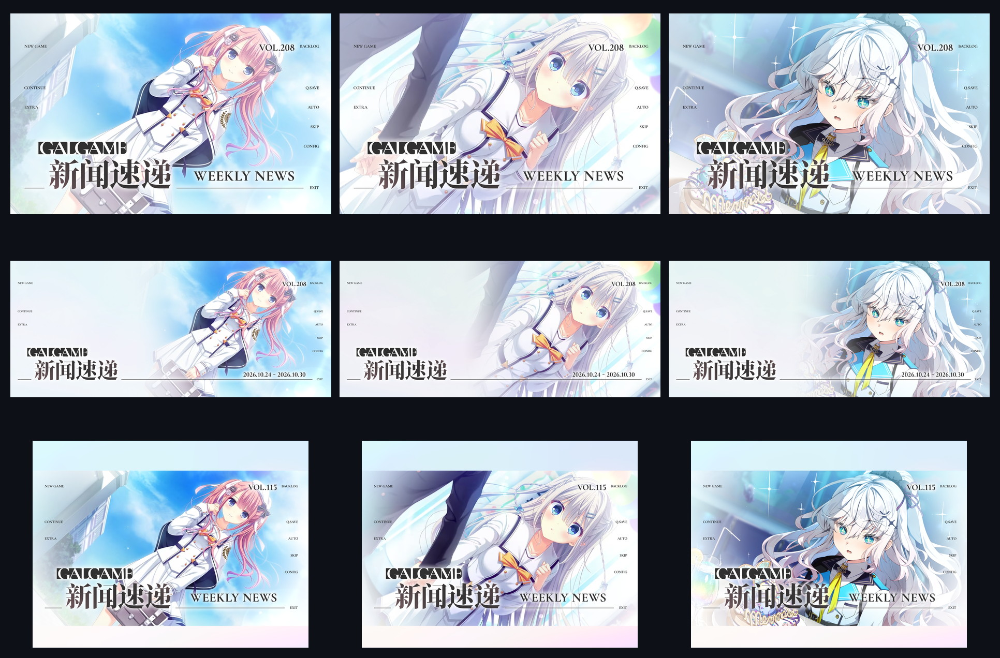
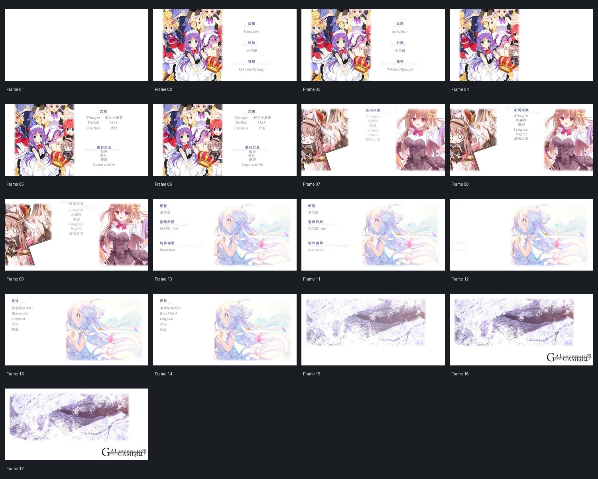

# Autoweekly Skills

四个独立的 skill，可由 Codex、WorkBuddy 等本地智能体调用，生成 Galgame 周报配图、片头和片尾。
Windows 封面、角标通过 Photoshop 原生 COM / `DoJavaScriptFile` 驱动；Mac 封面通过 Photoshop 脚本菜单执行一次性 JSX。片头使用
After Effects 独立后台实例、JSX 与 aerender。Windows 原生调用不依赖模拟点击；Mac 封面的脚本菜单可由用户或电脑操作工具执行。

| Skill | 用途 |
| --- | --- |
| `weekly-bgm-overlay` | 根据 BGM 信息，批量生成新作 / 汉化 / 周边 / 简讯四栏的透明 PNG 辅助角标。 |
| `weekly-cover` | 把 CG 立绘放进三个封面模板（16:9、横幅、4:3），按 CG 边缘主色自动配色，并避开人脸遮挡。 |
| `weekly-intro` | 从指定图片范围选图，替换现成 AE 片头模板，在独立副本中继承 Voukoder 队列并后台导出 MP4。 |
| `weekly-outro` | 按期号读取 XLSX 或飞书名单，替换现成 AE 片尾中的署名和指定范围图片，继承 Voukoder 后台导出。 |

`weekly-intro`、`weekly-outro` 的本地包由 `python tools/package_skills.py` 生成；尚未发布到上述旧版 Release。
它使用用户现有 AEP，不附带私人模板或新闻图包。调用流程见
[片头技能说明](weekly-intro/SKILL.md)，媒体核验依赖 FFmpeg/FFprobe；存在启用的文本层时还需 fontTools 校验字体。
片尾流程见[片尾技能说明](weekly-outro/SKILL.md)，本地工作表读取另需 openpyxl；飞书 API 需自行配置目标表的读取权限。

## 在其他智能体中调用

同一份 skill 也可交给 **WorkBuddy 等具备本地文件、终端和看图能力的智能体**执行。
模板选择和 Photoshop 渲染流程保持一致，按平台自己的安装入口导入即可。

| 使用方式 | 操作 |
| --- | --- |
| WorkBuddy 本地导入 | 下载下方独立 ZIP，在「技能 → 添加技能 → 上传技能」中导入 |
| 其他支持 skill 的客户端 | 将完整技能文件夹放入该平台配置的技能目录 |
| 没有技能导入入口 | 让智能体读取本地 `SKILL.md` 绝对路径，按文档执行脚本 |

**[下载通用导入包](https://github.com/GalgameCriticism/Autoweekly-skills/releases/tag/skills-portable-v1)**：
`weekly-cover.zip` / `weekly-bgm-overlay.zip`。每个包的根目录含 `SKILL.md`、脚本和参考文档，
PSD 仍由下载脚本另行获取。需要重新打包时运行 `python tools/package_skills.py`。

首次调用可让智能体运行 `python '<skill>/scripts/doctor.py'`，读取 JSON 中的依赖、
模板路径和 Photoshop 路径建议，再用 `--photoshop`、`--output` 显式传参。
诊断不会启动 Photoshop 或改配置；字体与实际渲染仍需后续检查。

更多约定见[智能体兼容说明](docs/agent-compatibility.md)。WorkBuddy 的本地包导入方式依据
[官方文档](https://www.workbuddy.cn/docs/workbuddy/From-Beginner-to-Expert-Guide/Function-Description/Skills-Market)；
当前验证覆盖独立包解压后的脚本调用，未实测其他客户端的导入界面。

## 效果预览

### weekly-cover：周报封面

`weekly-cover` 的实际产出——每行一种模板，每列一张 CG（自上而下：16:9 主封面、
横幅、4:3；横幅为 refine 后的配色版本）：

[](assets/preview.jpg)

### weekly-bgm-overlay：BGM 辅助角标

四类栏目的透明 PNG 角标（棋盘格代表透明区域，实际使用时叠加在视频画面上）。
左上 → 右下依次为新作情报、汉化情报、周边情报、简讯：

[](assets/preview-overlay.jpg)

### weekly-outro：周报片尾

后台自动化生成的周报片尾抽帧，覆盖 STAFF、栏目、新闻图、季节衔接和结尾。
名单与图片从本地输入替换，分发包不包含模板、名单或原始新闻图：

[](assets/preview-outro.jpg)

点击图片可查看原尺寸。

> 预览中的 CG 立绘、曲目与作者信息仅用于演示效果，版权归原作者 / 发行方
> 所有。母版通过 Release 分发；字体与原始 CG 不随本仓库或 Release 分发。

## 三步上手

以下命令在 PowerShell 中执行，`python` 指向 Python 3.11 或更高版本。

### 1. 安装 skill

```powershell
git clone https://github.com/GalgameCriticism/Autoweekly-skills.git
Copy-Item -Recurse .\Autoweekly-skills\weekly-cover "$env:USERPROFILE\.codex\skills\weekly-cover"
Copy-Item -Recurse .\Autoweekly-skills\weekly-bgm-overlay "$env:USERPROFILE\.codex\skills\weekly-bgm-overlay"
```

如果目录已存在，自行决定如何合并或更新，不要盲目覆盖已有配置。

安装 Python 依赖：`python -m pip install Pillow numpy`。

### 2. 下载母版

智能体首次使用时可以自动执行以下下载步骤。手动安装时，每个 skill 运行一次即可，
脚本会自动下载到默认缓存目录，并做 SHA256
和 PSD 尺寸校验：

```powershell
python "$env:USERPROFILE\.codex\skills\weekly-cover\scripts\download_templates.py"
python "$env:USERPROFILE\.codex\skills\weekly-bgm-overlay\scripts\download_templates.py"
```

默认缓存目录：

- 优先使用 `$env:LOCALAPPDATA\Autoweekly\templates\templates-v1`
- 没有 `LOCALAPPDATA` 时回退到 `~/.cache/Autoweekly/templates/templates-v1`

需要下载到其他目录时，先用 `--directory` 指定位置，再让 skill 使用它：

```powershell
python '<skill>\scripts\download_templates.py' --directory 'D:/Autoweekly/templates'
$env:AUTOWEEKLY_TEMPLATE_DIR = 'D:/Autoweekly/templates'
```

### 3. 使用

告诉智能体 Photoshop 的安装位置，或让它从本机安装信息中查找。
手动执行命令时，先把下面路径改为自己的 `Photoshop.exe`：

```powershell
$photoshop = 'C:/Program Files/Adobe/Adobe Photoshop 2023/Photoshop.exe'
$env:WEEKLY_COVER_PHOTOSHOP = $photoshop
$env:WEEKLY_OVERLAY_PHOTOSHOP = $photoshop
```

直接在聊天里说一句话即可，例如：

- 封面：**"用这张 CG 生成本周的三种周报封面，输出到
  `./output/covers`。"**
- 角标：**"本周 BGM 是折戸伸治的《夏休みの過ごし方》，生成新作和汉化角标，
  输出到 `./output/overlays`。"**

智能体需要实际跑命令时，典型流程是先用 `prepare --output` 建独立批次，
再 `render` 调用 Photoshop：

```powershell
python '<skill>/scripts/cover.py' prepare --cg '<cg.png>' --template all --issue 267 --output './output/covers'
python '<skill>/scripts/cover.py' render '<run_dir>'

python '<skill>/scripts/overlay.py' prepare --input '<input.txt>' --output './output/overlays'
python '<skill>/scripts/overlay.py' render '<run_dir>'
```

输出目录由 `prepare --output` 决定，建议始终指向你自己的工作区，不要依赖
作者本机的默认输出路径。

## macOS 适用性

`weekly-cover` 支持 macOS Photoshop 的原生 JSX 渲染：先 `prepare --issue 267`，再 `render` 获取一次性 `run_mac.jsx`，在 Photoshop「文件 → 脚本 → 浏览」执行，最后运行 `verify`。`render` 返回 `awaiting_photoshop` 表示等待执行，不是已导出；可选校色执行后用 `verify --refined` 核验。最终只交付 `exports/` 内的 PNG，每张不超过 5,000,000 字节；文件名为「xx 期周报视频封面 4-3」「xx 期周报视频封面 16-10」「xx 期周报文章封面」。详见 [封面 Skill](weekly-cover/SKILL.md)。Mac 不自动启动 Photoshop，也不申请 AppleScript 自动化权限。

角标以及 AE 片头/片尾的原生渲染仍只支持 Windows。Mac 请使用 Python 3.11+ 明确路径创建虚拟环境；系统 `python3` 可能是 3.9。`doctor` 会分别报告是否支持渲染和直接调用，模板、字体与实际输出仍须检查。

试用封面时使用本机生成的独立批次，不把别人提供的 run 目录当成可执行任务。渲染会重新从已安装引擎生成 JSX，核对暂存素材哈希和输出路径；并发提交、已有输出、已打开的同批模板都会停止，避免覆盖或丢失编辑。历史批次和失败回执保留供检查，不通过删除回执盲目重跑。

## 运行环境

- 封面：Windows 或 macOS，已安装 Adobe Photoshop 2023 或更高版本；其他技能的原生渲染仍需 Windows。
- Python 3.11+（模板校验使用 `hashlib.file_digest`）。
- Python 包：`Pillow`；`weekly-bgm-overlay` 还需要 `numpy`。
- COM 桥接使用 Windows PowerShell 5.1。
- 角标母版需安装 MiSans-Semibold、MiSans-Regular、NotoSerifCJKsc-SemiBold 对应字体。

## 母版列表

母版合计约 257 MB，不纳入 git 历史，统一作为 Release 附件分发：

**[下载 templates-v1](https://github.com/GalgameCriticism/Autoweekly-skills/releases/tag/templates-v1)**

| 文件 | 用途 | 画布 | 大小 |
| --- | --- | --- | --- |
| `weekly-cover-t1-16x9.psd` | `weekly-cover` T1 主封面 | 2400×1500 | 45.2 MB |
| `weekly-cover-t2-banner.psd` | `weekly-cover` T2 横幅 | 3525×1500 | 76.8 MB |
| `weekly-cover-t3-4x3.psd` | `weekly-cover` T3 4:3 | 2400×1800 | 90.0 MB |
| `weekly-bgm-overlay-master.psd` | `weekly-bgm-overlay` 角标母版 | 2160×1080 | 44.7 MB |

下载脚本会自动校验 SHA256 和 PSD 尺寸。手动校验时：

```powershell
Get-FileHash .\weekly-cover-t1-16x9.psd -Algorithm SHA256
```

期望哈希见 Release 说明或各 skill 的 `references/` 文档。

## 模板优先级

skill 按以下顺序解析模板：

1. 单模板环境变量，例如 `WEEKLY_COVER_T1_SOURCE`、`WEEKLY_OVERLAY_TEMPLATE`。
2. 原作者母版路径（如果这台机器上仍然存在）。
3. 下载脚本写入的默认缓存或 `AUTOWEEKLY_TEMPLATE_DIR` 指定的缓存。

显式设置的单模板变量始终优先，路径无效时会报错，请修正或移除该变量。
新环境下载到默认缓存后，无需再手填四个模板路径。

## 进阶配置

只有需要自定义 Photoshop 或模板位置时才设置下面的环境变量。

<details>
<summary>环境变量表</summary>

| 变量 | 作用 |
| --- | --- |
| `WEEKLY_COVER_T1_SOURCE` | T1 16:9 封面母版 PSD |
| `WEEKLY_COVER_T2_SOURCE` | T2 横幅母版 PSD |
| `WEEKLY_COVER_T3_SOURCE` | T3 4:3 母版 PSD |
| `WEEKLY_OVERLAY_TEMPLATE` | BGM 角标母版 PSD |
| `AUTOWEEKLY_TEMPLATE_DIR` | 覆盖模板缓存目录 |
| `WEEKLY_COVER_PHOTOSHOP` | `Photoshop.exe` 路径 |
| `WEEKLY_OVERLAY_PHOTOSHOP` | `Photoshop.exe` 路径 |

</details>

## 目录结构

```
weekly-bgm-overlay/
  SKILL.md
  agents/openai.yaml
  references/task-schema.md
  scripts/download_templates.py
  scripts/overlay.py
  scripts/runtime/...

weekly-cover/
  SKILL.md
  references/templates.md
  scripts/download_templates.py
  scripts/cover.py
  scripts/runtime/...
```

每个文件夹都是一个独立 skill：把安装器指向含 `SKILL.md` 的目录即可，例如
`.../Autoweekly-skills/weekly-cover`。

## 说明

- 母版 PSD 通过 Release 分发；字体与原始 CG 不随本仓库或 Release 分发。
- 每次渲染前先 `prepare` 创建独立批次；已提交的批次会拒绝再次提交，
  避免重复渲染。
- 渲染完成后程序核验只确认尺寸与可读性，仍需人工目视检查关键效果。
