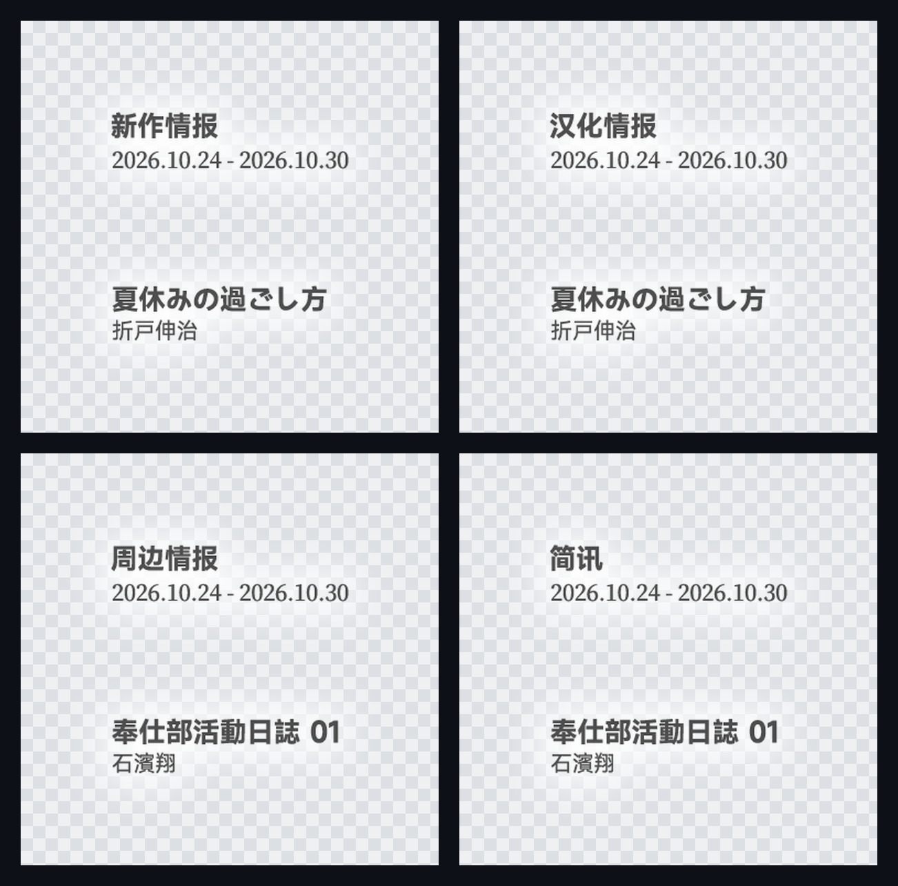

# Autoweekly Skills

两个独立的 Codex skill，用于借助 Adobe Photoshop 生成 Galgame 周报配图。
全部通过 Photoshop 原生 COM / `DoJavaScriptFile` 接口驱动，**不依赖
Computer Use，也不需要模拟点击界面**。

| Skill | 用途 |
| --- | --- |
| `weekly-bgm-overlay` | 根据 BGM 信息，批量生成新作 / 汉化 / 周边 / 简讯四栏的透明 PNG 辅助角标。 |
| `weekly-cover` | 把 CG 立绘放进三个封面模板（16:9、横幅、4:3），按 CG 边缘主色自动配色，并避开人脸遮挡。 |

## 效果预览

### weekly-cover：周报封面

`weekly-cover` 的实际产出——每行一种模板，每列一张 CG（自上而下：16:9 主封面、
横幅、4:3；横幅为 refine 后的配色版本）：

[](assets/preview.jpg)

### weekly-bgm-overlay：BGM 辅助角标

四类栏目的透明 PNG 角标（棋盘格代表透明区域，实际使用时叠加在视频画面上）。
左上 → 右下依次为新作情报、汉化情报、周边情报、简讯：

[](assets/preview-overlay.jpg)

点击图片可查看原尺寸。

> 预览中的 CG 立绘、曲目与作者信息仅用于演示效果，版权归原作者 / 发行方
> 所有；仓库不分发 PSD 母版、字体或客户素材。

## 目录结构

```
weekly-bgm-overlay/
  SKILL.md
  agents/openai.yaml
  references/task-schema.md
  scripts/overlay.py
  scripts/runtime/...

weekly-cover/
  SKILL.md
  references/templates.md
  scripts/cover.py
  scripts/runtime/...
```

每个文件夹都是一个独立 skill：把安装器指向含 `SKILL.md` 的目录即可，例如
`.../Autoweekly-skills/weekly-cover`。

## 运行环境

- Windows，且已安装 Adobe Photoshop 2023 或更高版本。
- Python 3，并安装 `Pillow`（`weekly-bgm-overlay` 还需要 `numpy`）。
- COM 桥接必须用 Windows PowerShell 5.1（不要用 PowerShell 7 跑 COM）。
- 需要 4 个 PSD 母版，见下方「模板下载」。

## 模板下载

母版合计约 257 MB，不纳入 git 历史，统一作为 Release 附件分发：

**[下载 templates-v1](https://github.com/GalgameCriticism/Autoweekly-skills/releases/tag/templates-v1)**

| 文件 | 用途 | 画布 | 大小 |
| --- | --- | --- | --- |
| `weekly-cover-t1-16x9.psd` | `weekly-cover` T1 主封面 | 2400×1500 | 45.2 MB |
| `weekly-cover-t2-banner.psd` | `weekly-cover` T2 横幅 | 3525×1500 | 76.8 MB |
| `weekly-cover-t3-4x3.psd` | `weekly-cover` T3 4:3 | 2400×1800 | 90.0 MB |
| `weekly-bgm-overlay-master.psd` | `weekly-bgm-overlay` 角标母版 | 2160×1080 | 44.7 MB |

下载后可校验：

```powershell
Get-FileHash .\weekly-cover-t1-16x9.psd -Algorithm SHA256
```

期望哈希见 [Release 说明](https://github.com/GalgameCriticism/Autoweekly-skills/releases/tag/templates-v1)
或各 skill 的 `references/` 文档。

## 路径配置

两个 skill 默认指向作者本机路径。请用环境变量覆盖成你自己的路径；未设置时
回退到作者默认值。

`weekly-cover`

- `WEEKLY_COVER_T1_SOURCE` —— 16:9 模板 PSD
- `WEEKLY_COVER_T2_SOURCE` —— 横幅模板 PSD
- `WEEKLY_COVER_T3_SOURCE` —— 4:3 模板 PSD
- `WEEKLY_COVER_PHOTOSHOP` —— `Photoshop.exe` 路径
- `WEEKLY_COVER_OUTPUT` —— 默认输出目录

`weekly-bgm-overlay`

- `WEEKLY_OVERLAY_TEMPLATE` —— 角标母版 PSD
- `WEEKLY_OVERLAY_PHOTOSHOP` —— `Photoshop.exe` 路径

## 安装

```powershell
git clone https://github.com/GalgameCriticism/Autoweekly-skills.git
Copy-Item -Recurse .\Autoweekly-skills\weekly-cover "$env:USERPROFILE\.codex\skills\weekly-cover"
Copy-Item -Recurse .\Autoweekly-skills\weekly-bgm-overlay "$env:USERPROFILE\.codex\skills\weekly-bgm-overlay"
```

## 说明

- PSD 母版、字体、客户素材均不纳入版本库。
- 渲染按运行目录确定且可重复；每次运行都会写出 `job.json` 及核验记录。
